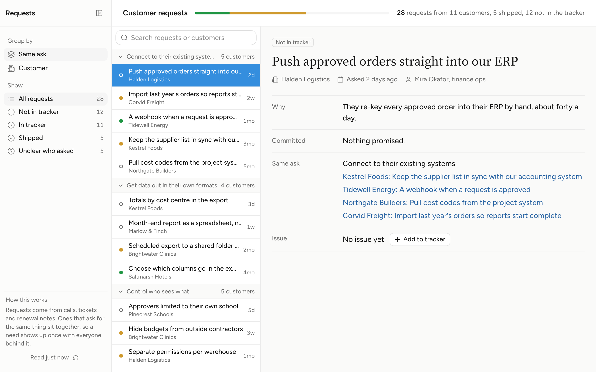
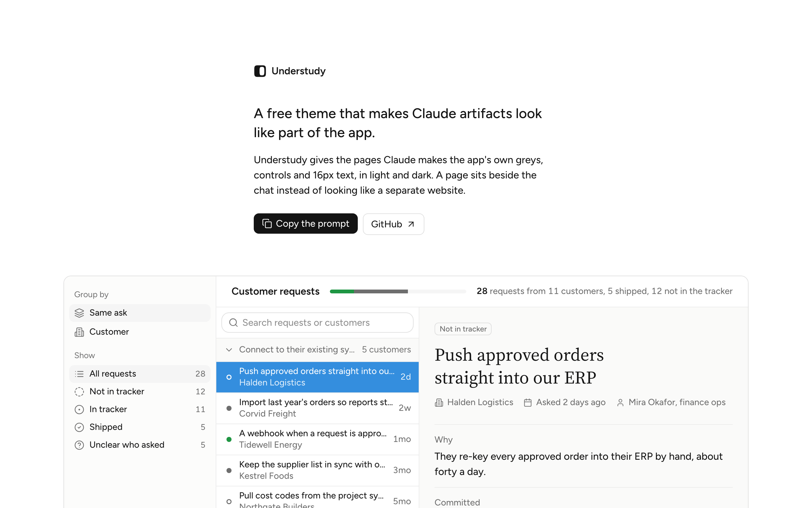
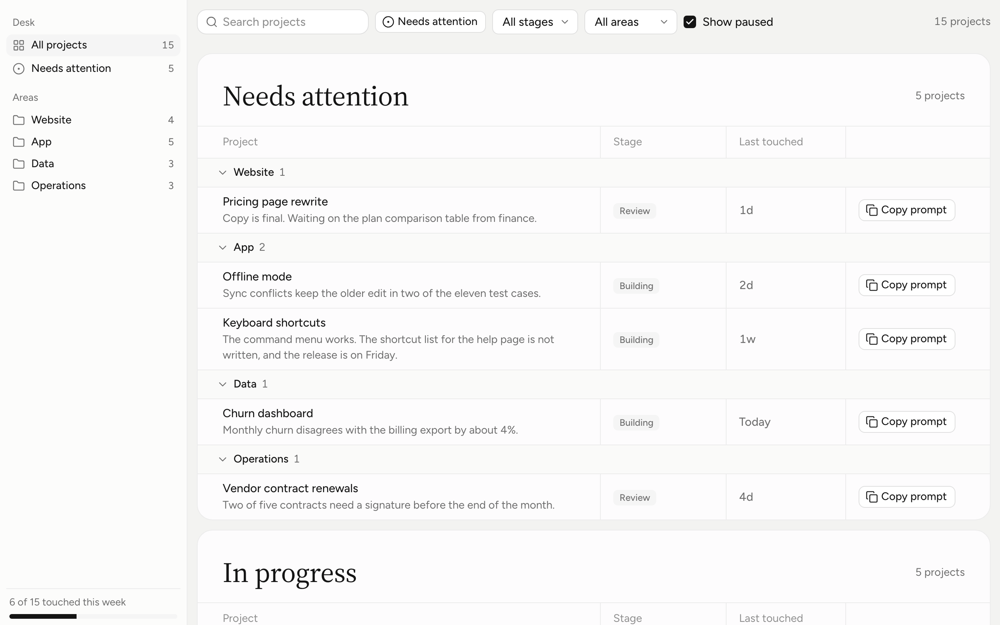
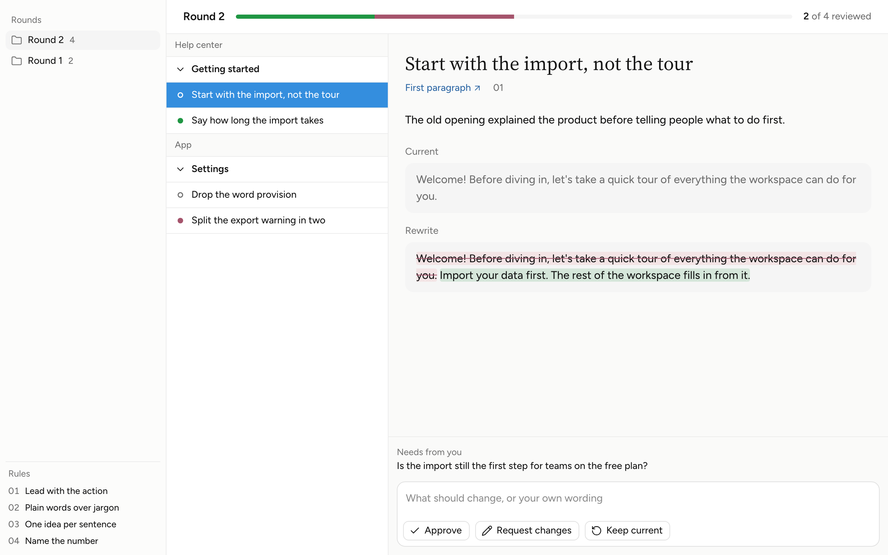

# Changelog

What changed in Understudy, newest first. Each entry names the classes it touches, so you can tell whether a page you built has the latest. Changes collect under Unreleased as they merge, already in `components.css`, and get a dated entry when they are announced, usually once a week. The site shows this file at [understudyui.com/changelog](https://understudyui.com/changelog), with a [feed](https://understudyui.com/changelog.xml).

## Unreleased

### Changed

- `us-check` lines its box up with the first line of the label, so a label that wraps hangs below the box instead of the box centring on both lines.
- The changelog page reads like a product changelog: the date beside each release on a timeline, a one-line intro, a heading, short paragraph and picture (light and dark) per feature, and a Smaller improvements list, with the classes each release touched folded behind one line; every release is written this way, and the top area uses the homepage's narrow column. The homepage demos five of the seven examples, each tab named for what the example is (Request tracker, Project desk, Release checklist, Demo script, Launch storyboard), with the tabs above the demo, and lists the Claude design system. The README covers the design system copy, the release script, how a release is written, what clicking the time strip does and the live examples on the site, with a current picture at the top and pictures for the run of show and storyboard. No class changes.
- The review tool example (`examples/tool.html`) has a Workspace nav: its filters move there from tabs, with counts, and each check is listed with its status dot as a link to it. The storyboard's and the run of show's side gutters grow with the window, up to 64px. No class changes.
- `us-select` can hold a `button` and a `us-menu` instead of a native `select`, so its menu opens below it; `us-menu[hidden]` hides a closed menu. The project desk example uses it for Stage and Area, and drops its Needs attention button, which the nav already has, so its filter bar fits one line.
- A `us-tracker` at the foot of `us-workspace-nav` has 12px under its bar, so it no longer sits on the nav's edge.
- `us-timeline` has 16px above its segments when it sticks, instead of 8px, so it no longer sits on the window's edge. A `us-beat` lands right under it when its segment is clicked, and a `us-frame` lands 24px under it. The run of show and storyboard examples mark the clicked segment until you scroll yourself, and glide to it unless reduced motion is on. A click scrolls only the example's own page, so a site showing it in a frame stays where it is.
- The project desk example opens with its Tasks table, above the projects by stage, and its Project column keeps at least 180px so names read instead of being cut to a few letters. No class changes.

## 2026-11-06: Storyboards, a run of show, and pages that fit a phone

Two new layouts for work that happens in time, pages that fit a phone, and a handful of new pieces for tools you work in.

#### Storyboards

A layout for the frames of something you are making, such as a product video or a motion piece. Every frame is the same 16:9 size, with its time, the shot and the voiceover, and an arrow to the next frame names the cut. Play animatic runs the frames at their lengths with the caption under each.

#### A run of show

A layout for anything you run live in time order: a demo, a talk, a walkthrough on a call. A strip across the top shows every beat, as wide as it is long, and stays in view as you scroll. Each beat pairs a drawn screen of what is showing, whether a website, slides, a terminal, an editor, a phone or a video call, with what to do and say.

#### Pages that fit a phone

On a phone the workspace nav opens as a drawer, and a split list shows either the list or one record, with a back button between them.

#### Cards, menus, tooltips and sheets

A grid of cards for scanning many records of one kind, a tab that opens a menu below it for filtering, a shared tooltip, a panel that slides in from the right, row thumbnails and a button that reads as text.

#### Smaller improvements

- Table rows fit their content instead of a 56px minimum, and a group's heading is a full-width band you click to fold
- Status dots are 10px and built like the macOS window buttons, and progress bars use flat traffic light colors
- Tabs can lead with an icon and end with a count
- Avatars come in six colors, each readable under white initials
- Label and value rows, markdown read in place, and links that leave the page with an arrow
- The workspace nav's top band stays pinned while the nav scrolls, and pages keep clear of a notch
- The Claude design system copy carries the tokens, so a Claude canvas can install it

### Added

- Storyboard, a layout for the frames of something being made, with `examples/storyboard.html`: `us-board` and `us-frame` with `us-frame-head`, `us-frame-title`, `us-frame-time`, `us-frame-sketch` (`is-device`), `us-frame-shot`, `us-frame-caption` and `us-frame-transition`; and `us-animatic` with `us-animatic-stage`, `us-animatic-caption` and `us-animatic-bar` to play the frames at their lengths. It reuses the run of show's timeline strip and screens.
- Run of show, a layout for anything run in time order, with `examples/run-of-show.html`: `us-timeline`, segments sized by `--us-span` with short names, the beat in view dark; `us-beat` with `us-beat-head`, `us-beat-time`, `us-beat-title`, `us-beat-notes`, `us-beat-label`, `us-beat-say`; and `us-screen`, a drawn window, with `us-screen-bar`, `us-screen-dots`, `us-screen-title`, `is-page` for a website or app at 16:10, `is-slide` with `us-deck`, `us-deck-rail`, `us-deck-thumb` (`is-current`), `us-deck-stage`, `us-slide`, `us-slide-title`, `us-slide-text` and `us-slide-num` for a presentation tool, `us-screen-term`, a drawn terminal, with `us-term-cmd`, `us-term-dim`, `us-term-ok`, `us-term-link` and `us-term-caret`. Screens for other kinds of beat: `us-phone` with `us-phone-screen` for a phone; `is-call` with `us-call`, `us-call-tile` (`is-main`), `us-call-side`, `us-call-face`, `us-call-name`, `us-call-bar` and `us-call-btn` (`is-end`) for a video call; `us-ide` with `us-ide-tree`, `us-ide-item` (`is-nested`, `is-open`) and `us-editor` with `us-editor-line` (`is-add`, `is-del`, `is-gap`) for a file in an editor; `is-talk` on a `us-beat` with nothing on screen. The strip sticks to the top as the page scrolls, and `aria-current` turns the segment of the beat in view dark.
- `us-tip`, `us-sheet` with `us-sheet-scrim`, `us-thumb` with `us-with-thumb`, and `us-text-btn`: a shared tooltip, a panel from the right, a row thumbnail and a button that reads as text.
- `us-tab-select`, `us-dd`, `us-menu`, `us-menu-item`, `us-menu-count`: a filter drawn as a tab with a chevron that opens a menu below it. `us-tab-count` for a count at the end of a tab.
- `us-cards` and `us-record-card`: a grid of equal-height cards, one per record, each with a head (logo, name, icon links, tags), a two-line summary, a row of icon-led facts and a short list under a hairline with an age per item.
- `us-dot is-blank`: keeps the dot's column and shows nothing, in a `us-split-row` selected or not.
- On a phone, the nav as a drawer: `is-drawer` on the workspace, a `us-nav-menu` button, `us-scrim`, `is-nav-open`. A paged Split that shows the list or one record: `is-paged`, `is-open`, `us-split-back`.
- `us-topbar` and `us-view`: a bar across the top of the right side, as tall as the nav's top band, and a full width view under it.
- The Claude design system copy now carries `tokens.css` and a Consuming section naming its namespace, `understudy`, so a Claude Design canvas can install and load it. No class changes.
- `us-fields` for label and value rows, `us-prose` and `us-prose-table` for markdown read in place, `a.us-out` for links that leave the page, `us-record-tags` above a record's title.
- In the nav: `us-nav-divider`, `us-side-note`, `us-legend`, and `us-row-out` on a row that leaves the page. Nav rows can be buttons.
- `us-split-empty` and `us-composer-note`.
- Avatar colors: `us-avatar` with `is-orange`, `is-pink`, `is-blue`, `is-green`, `is-purple` or `is-teal`, from tokens `avatar-orange` and so on, each 4.5:1 or better under white initials.
- Tokens `light-red`, `light-amber` and `light-green`.
- The nav's top band stays pinned while the rest of the nav scrolls under it. The workspace nav, main area and top band keep clear of a notch (`env(safe-area-inset-*)`).
- `us-row is-here` for the page you are on among links to sibling pages, and `us-icon-btn is-copied`.
- Understudy as a Claude design system, for Claude's canvas, decks and mockups: `scripts/build-design-system.mjs` builds it from this repo, with a guideline and live preview per component in `design-system/components/`.

### Changed

- `us-table` rows fit their content, 12px above and below, instead of a 56px minimum. `us-panel-head` sits 16px above what follows and aligns to the baseline; a `p` in it is a description tucked under the title. `us-panel` stops below the sticky top bar when jumped to. Pages that wrote these themselves can drop them.
- `us-tab` lays out inline, so a 14px icon and a count sit in line with its label.
- `us-table-group`, `us-table-toggle`, `us-table-count`: a group's heading is now a full-width grey band, and the whole band is the button. The label is small and grey, lined up with the first column's text, with the count at the right edge. Same markup.
- The README's status dot row now lists `is-warning` too.
- `us-dot` is 10px, and its colored states are built like the macOS window buttons: a gradient, a darker rim and a faint shadow. Chosen, not measured from the app.
- `us-progress` segments use the flat traffic light colors (`light-green`, `light-amber`, `light-red`). Tags and text keep `success`, `warning` and `danger`.
- A `us-split-row` dot sits 3px in, centred in the chevron's column at its new 10px size. Icons in `us-record-where` are 14px, each beside its text.
- Only the sorted header darkens: `th[aria-sort="none"]` no longer does.

### Fixed

- Building the site no longer deletes the Claude design system copy in `dist/design-system`. No class changes.

## 2026-10-31: Amber for work in motion

Work under way now reads as moving.

#### Amber for in progress

A grey in-progress dot looked like nothing was happening, so work under way is now amber, in dots, tags and progress bars, in light and dark.

#### What each dot means

Hollow for not started, amber for in motion, green for done, red for something that needs someone, and grey for parked. Both examples now show in-progress work in amber.

### Added

- Tokens `warning` and `warning-soft`, amber in light and dark, with `us-dot is-warning`, `us-tag-warning` and `is-warning` in `us-progress`.

### Changed

- The dots now mean: hollow for not started, `is-warning` for in motion, `is-success` for done, `is-danger` for needs someone, `is-muted` for parked. Both examples show in-progress work in amber.

## 2026-10-30: Tables people work in, and a nav that hides

A table you can work in, a nav that gets out of the way, and this changelog.

#### Tables people work in

Sort from any column header, drag any column's edge to resize it, and open a row to see the tasks underneath in the same columns. Each row can show a person with their initials, a status with its dot and word, and a short progress bar with a count.

#### A nav that hides

Hide the workspace nav from its button or with Cmd or Ctrl and backslash, and drag its edge to make it wider or narrower. Its top band lines up with the bar beside it, and a footer closes it.

#### Smaller improvements

- Split groups fold, rows show a name and a short date, and the detail centres in a wide column
- A changelog on the site with a feed, and an Updated line on the homepage linking to the newest release

### Added

- Sort from any column header with `us-th-sort`; the sorted header carries `aria-sort` and a small arrow.
- Resize columns from any row: a `us-drag` strip per header, the full height of the table through `--us-table-h`, inside an `is-resizable` wrap.
- Rows that open with `us-row-toggle`; their `us-table-child` rows use the same columns. Fixed widths with `is-fixed`, so nothing shifts.
- `us-person` and `us-avatar`, with an `is-none` placeholder for nobody; `us-status` and `us-progress-cell`.
- The workspace nav hides (its button, or Cmd or Ctrl and backslash) and resizes; `us-nav-top` lines up with the bar beside it, and `us-nav-foot` closes it.
- Split groups fold with `is-toggle` and `us-split-count`; rows take `us-split-name` and a short `us-split-when` date; `us-split-page` centres the detail.
- This changelog, on the site at /changelog with a feed, and an "Updated" line under the homepage's buttons that links to the newest entry.

### Changed

- New token `top-bar-height` (57px). The tracker uses it as its minimum height.

[See the change on GitHub](https://github.com/kelvinman/understudy/pull/2)

## 2026-10-29: A website, and two examples rebuilt

A home for Understudy on the web, and examples that look like real work.

#### understudyui.com

A site built from the repo itself, with a live example to click through and a prompt to copy. It copies in the tokens, components and examples on every build, so it never drifts from the repo.

#### Two examples rebuilt

The request tracker and the project desk now hold realistic sample data and the pieces they were missing, so they show how a real tool reads.

### Added

- The site at understudyui.com. It copies in the tokens, components and examples on every build, so it never drifts from the repo.

### Changed

- The request tracker and the project desk examples, rebuilt with sample data and the pieces they were missing.

[See the change on GitHub](https://github.com/kelvinman/understudy/commit/5e826b9)

## 2026-10-28: Understudy, first release

A theme that makes Claude artifacts look like part of the desktop app, released free under the MIT license.

#### A theme that matches the app

The app's own greys, quiet bordered controls and 16px text, in light and dark, measured from the Claude desktop app. Dark mode is set a step lower to land on the app's colors inside the artifact pane.

#### Five layouts to start from

A tool or tracker, a report, a short page, and a workspace as cards or full width, each an example page you can copy from.

### Added

- Tokens in light and dark, `components.css` with the `us-` classes, and five example pages, one per layout.

### Fixed

- The quote button hides when it is marked hidden.
- The sidebar resize strip in the full-width example.

[See the changes on GitHub](https://github.com/kelvinman/understudy/commits/main)
