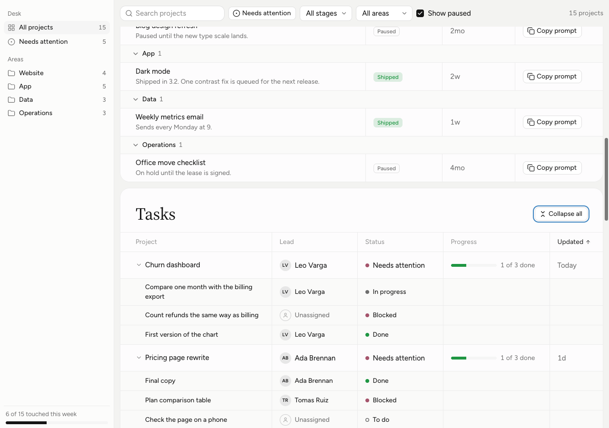

# Changelog

What changed in Understudy, newest first. Each entry names the classes it touches, so you can tell whether a page you built has the latest. The site shows this file at [understudyui.com/changelog](https://understudyui.com/changelog), with a [feed](https://understudyui.com/changelog.xml).

## 2026-10-30: Tables people work in, and a nav that hides

A table you can sort, resize and open, built for lists of work with owners and status. The workspace nav and the Split catch up with patterns first made for the Claude desktop board.

### Added

- Sort from any column header with `us-th-sort`; the sorted header carries `aria-sort` and a small arrow.
- Resize columns from any row: a `us-drag` strip per header, the full height of the table through `--us-table-h`, inside an `is-resizable` wrap.
- Rows that open with `us-row-toggle`; their `us-table-child` rows use the same columns. Fixed widths with `is-fixed`, so nothing shifts.
- `us-person` and `us-avatar`, with an `is-none` placeholder for nobody; `us-status` and `us-progress-cell`.
- The workspace nav hides (its button, or Cmd or Ctrl and backslash) and resizes; `us-nav-top` lines up with the bar beside it, and `us-nav-foot` closes it.
- Split groups fold with `is-toggle` and `us-split-count`; rows take `us-split-name` and a short `us-split-when` date; `us-split-page` centres the detail.
- This changelog, on the site at /changelog with a feed.

### Changed

- New token `top-bar-height` (57px). The tracker uses it as its minimum height.

[See the change on GitHub](https://github.com/kelvinman/understudy/pull/2)

## 2026-10-29: A website, and two examples rebuilt

understudyui.com, built from the repo itself, and the two examples reworked with real sample data.

### Added

- The site at understudyui.com. It copies in the tokens, components and examples on every build, so it never drifts from the repo.

### Changed

- The request tracker and the project desk examples, rebuilt with sample data and the pieces they were missing.

[See the change on GitHub](https://github.com/kelvinman/understudy/commit/5e826b9)

## 2026-10-28: Understudy, first release

A theme that makes Claude artifacts look like part of the desktop app, released free under the MIT license.

### Added

- Tokens in light and dark, `components.css` with the `us-` classes, and five example pages, one per layout.

### Fixed

- The quote button hides when it is marked hidden.
- The sidebar resize strip in the full-width example.

[See the changes on GitHub](https://github.com/kelvinman/understudy/commits/main)
