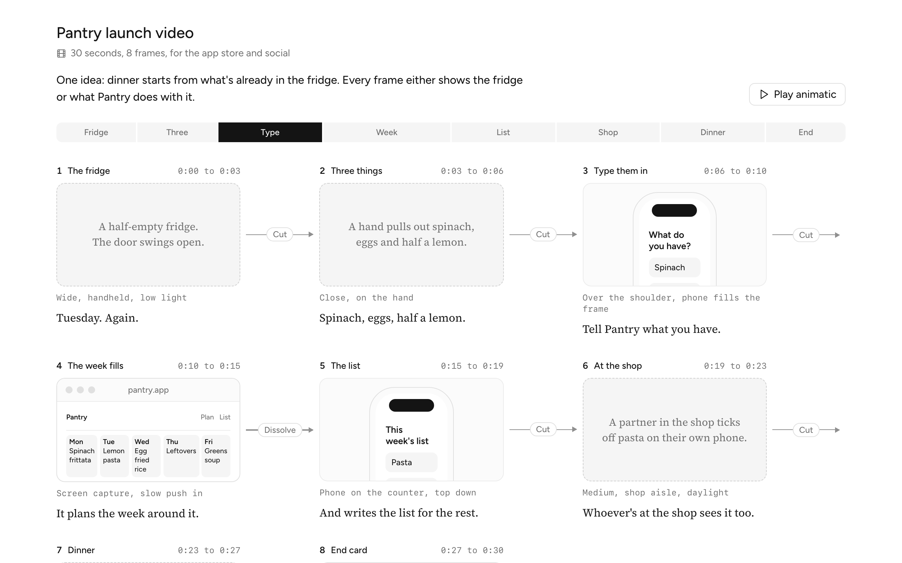
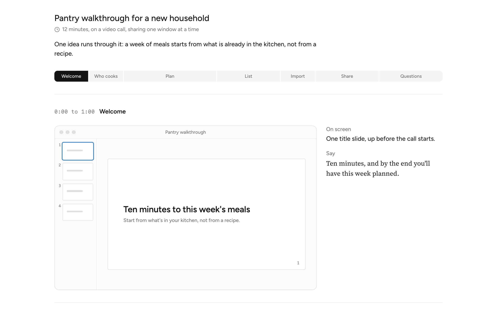
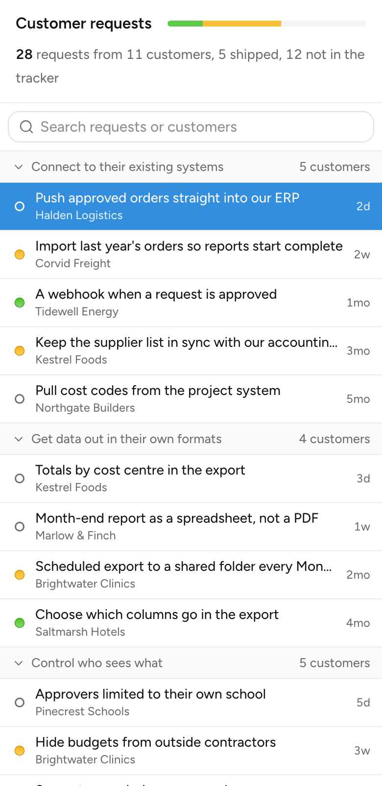
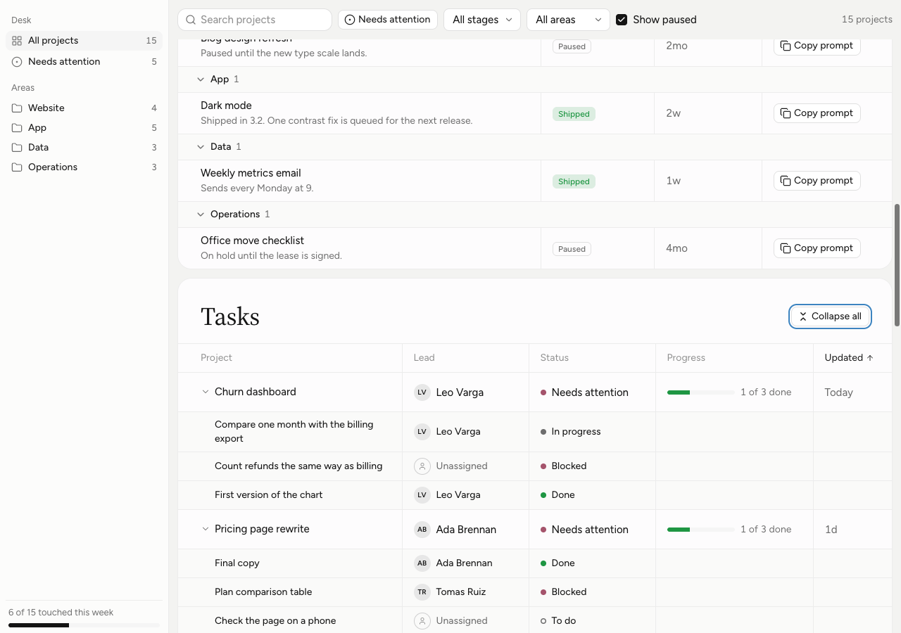

# Changelog

What changed in Understudy, newest first. Each entry names the classes it touches, so you can tell whether a page you built has the latest. Changes collect under Unreleased as they merge, already in `components.css`, and get a dated entry when they are announced, usually once a week. The site shows this file at [understudyui.com/changelog](https://understudyui.com/changelog), with a [feed](https://understudyui.com/changelog.xml).

## Unreleased

### Changed

- `us-check` lines its box up with the first line of the label, so a label that wraps hangs below the box instead of the box centring on both lines.
- The changelog page is a timeline: the date beside each release, its pictures (more than one, in light and dark), and its changes grouped under Added, Changed and Fixed with a count, long lists folded after five. The homepage demos five of the seven examples, with the example tabs 24px under the demo, and lists the Claude design system. The README covers the design system copy, the release script and pictures for the run of show and storyboard. No class changes.
- The review tool example (`examples/tool.html`) has a Workspace nav: its filters move there from tabs, with counts, and each check is listed with its status dot as a link to it. The storyboard's side gutter grows with the window, up to 64px. No class changes.

## 2026-11-06: Storyboards, a run of show, and pages that fit a phone

Two new layouts for work that happens in time: a run of show for anything run beat by beat, and a storyboard whose frames play back as an animatic. Pages now fit a phone, with the nav as a drawer and a Split that shows one record at a time. Cards, menus, tooltips and sheets join the set, and tables, tabs and status dots read tighter and clearer.

### Added

- Storyboard, a layout for the frames of something being made, with `examples/storyboard.html`: `us-board` and `us-frame` with `us-frame-head`, `us-frame-title`, `us-frame-time`, `us-frame-sketch` (`is-device`), `us-frame-shot`, `us-frame-caption` and `us-frame-transition`; and `us-animatic` with `us-animatic-stage`, `us-animatic-caption` and `us-animatic-bar` to play the frames at their lengths. It reuses the run of show's timeline strip and screens.
- Run of show, a layout for anything run in time order, with `examples/run-of-show.html`: `us-timeline`, segments sized by `--us-span` with short names, the beat in view dark; `us-beat` with `us-beat-head`, `us-beat-time`, `us-beat-title`, `us-beat-notes`, `us-beat-label`, `us-beat-say`; and `us-screen`, a drawn window, with `us-screen-bar`, `us-screen-dots`, `us-screen-title`, `is-page` for a website or app at 16:10, `is-slide` with `us-deck`, `us-deck-rail`, `us-deck-thumb` (`is-current`), `us-deck-stage`, `us-slide`, `us-slide-title`, `us-slide-text` and `us-slide-num` for a presentation tool, `us-screen-term`, a drawn terminal, with `us-term-cmd`, `us-term-dim`, `us-term-ok`, `us-term-link` and `us-term-caret`. Screens for other kinds of beat: `us-phone` with `us-phone-screen` for a phone; `is-call` with `us-call`, `us-call-tile` (`is-main`), `us-call-side`, `us-call-face`, `us-call-name`, `us-call-bar` and `us-call-btn` (`is-end`) for a video call; `us-ide` with `us-ide-tree`, `us-ide-item` (`is-nested`, `is-open`) and `us-editor` with `us-editor-line` (`is-add`, `is-del`, `is-gap`) for a file in an editor; `is-talk` on a `us-beat` with nothing on screen. The strip sticks to the top as the page scrolls, and `aria-current` turns the segment of the beat in view dark.
- `us-tip`, `us-sheet` with `us-sheet-scrim`, `us-thumb` with `us-with-thumb`, and `us-text-btn`: a shared tooltip, a panel from the right, a row thumbnail and a button that reads as text.
- `us-tab-select`, `us-dd`, `us-menu`, `us-menu-item`, `us-menu-count`: a filter drawn as a tab with a chevron that opens a menu below it. `us-tab-count` for a count at the end of a tab.
- `us-cards` and `us-record-card`: a grid of equal-height cards, one per record, each with a head (logo, name, icon links, tags), a two-line summary, a row of icon-led facts and a short list under a hairline with an age per item.
- `us-dot is-blank`: keeps the dot's column and shows nothing, in a `us-split-row` selected or not.
- On a phone, the nav as a drawer: `is-drawer` on the workspace, a `us-nav-menu` button, `us-scrim`, `is-nav-open`. A paged Split that shows the list or one record: `is-paged`, `is-open`, `us-split-back`.
- `us-topbar` and `us-view`: a bar across the top of the right side, as tall as the nav's top band, and a full width view under it.
- The Claude design system copy now carries `tokens.css` and a Consuming section naming its namespace, `understudy`, so a Claude Design canvas can install and load it. No class changes.
- `us-fields` for label and value rows, `us-prose` and `us-prose-table` for markdown read in place, `a.us-out` for links that leave the page, `us-record-tags` above a record's title.
- In the nav: `us-nav-divider`, `us-side-note`, `us-legend`, and `us-row-out` on a row that leaves the page. Nav rows can be buttons.
- `us-split-empty` and `us-composer-note`.
- Avatar colors: `us-avatar` with `is-orange`, `is-pink`, `is-blue`, `is-green`, `is-purple` or `is-teal`, from tokens `avatar-orange` and so on, each 4.5:1 or better under white initials.
- Tokens `light-red`, `light-amber` and `light-green`.
- The nav's top band stays pinned while the rest of the nav scrolls under it. The workspace nav, main area and top band keep clear of a notch (`env(safe-area-inset-*)`).
- `us-row is-here` for the page you are on among links to sibling pages, and `us-icon-btn is-copied`.
- Understudy as a Claude design system, for Claude's canvas, decks and mockups: `scripts/build-design-system.mjs` builds it from this repo, with a guideline and live preview per component in `design-system/components/`.

### Changed

- `us-table` rows fit their content, 12px above and below, instead of a 56px minimum. `us-panel-head` sits 16px above what follows and aligns to the baseline; a `p` in it is a description tucked under the title. `us-panel` stops below the sticky top bar when jumped to. Pages that wrote these themselves can drop them.
- `us-tab` lays out inline, so a 14px icon and a count sit in line with its label.
- `us-table-group`, `us-table-toggle`, `us-table-count`: a group's heading is now a full-width grey band, and the whole band is the button. The label is small and grey, lined up with the first column's text, with the count at the right edge. Same markup.
- The README's status dot row now lists `is-warning` too.
- `us-dot` is 10px, and its colored states are built like the macOS window buttons: a gradient, a darker rim and a faint shadow. Chosen, not measured from the app.
- `us-progress` segments use the flat traffic light colors (`light-green`, `light-amber`, `light-red`). Tags and text keep `success`, `warning` and `danger`.
- A `us-split-row` dot sits 3px in, centred in the chevron's column at its new 10px size. Icons in `us-record-where` are 14px, each beside its text.
- Only the sorted header darkens: `th[aria-sort="none"]` no longer does.

### Fixed

- Building the site no longer deletes the Claude design system copy in `dist/design-system`. No class changes.

## 2026-10-31: Amber for work in motion

Work under way now reads as moving. A grey in-progress dot looked like nothing was happening.

### Added

- Tokens `warning` and `warning-soft`, amber in light and dark, with `us-dot is-warning`, `us-tag-warning` and `is-warning` in `us-progress`.

### Changed

- The dots now mean: hollow for not started, `is-warning` for in motion, `is-success` for done, `is-danger` for needs someone, `is-muted` for parked. Both examples show in-progress work in amber.

## 2026-10-30: Tables people work in, and a nav that hides

A table you can sort, resize and open, built for lists of work with owners and status. The workspace nav and the Split catch up with patterns first made for the Claude desktop board.

### Added

- Sort from any column header with `us-th-sort`; the sorted header carries `aria-sort` and a small arrow.
- Resize columns from any row: a `us-drag` strip per header, the full height of the table through `--us-table-h`, inside an `is-resizable` wrap.
- Rows that open with `us-row-toggle`; their `us-table-child` rows use the same columns. Fixed widths with `is-fixed`, so nothing shifts.
- `us-person` and `us-avatar`, with an `is-none` placeholder for nobody; `us-status` and `us-progress-cell`.
- The workspace nav hides (its button, or Cmd or Ctrl and backslash) and resizes; `us-nav-top` lines up with the bar beside it, and `us-nav-foot` closes it.
- Split groups fold with `is-toggle` and `us-split-count`; rows take `us-split-name` and a short `us-split-when` date; `us-split-page` centres the detail.
- This changelog, on the site at /changelog with a feed, and an "Updated" line under the homepage's buttons that links to the newest entry.

### Changed

- New token `top-bar-height` (57px). The tracker uses it as its minimum height.

[See the change on GitHub](https://github.com/kelvinman/understudy/pull/2)

## 2026-10-29: A website, and two examples rebuilt

understudyui.com, built from the repo itself, and the two examples reworked with real sample data.

### Added

- The site at understudyui.com. It copies in the tokens, components and examples on every build, so it never drifts from the repo.

### Changed

- The request tracker and the project desk examples, rebuilt with sample data and the pieces they were missing.

[See the change on GitHub](https://github.com/kelvinman/understudy/commit/5e826b9)

## 2026-10-28: Understudy, first release

A theme that makes Claude artifacts look like part of the desktop app, released free under the MIT license.

### Added

- Tokens in light and dark, `components.css` with the `us-` classes, and five example pages, one per layout.

### Fixed

- The quote button hides when it is marked hidden.
- The sidebar resize strip in the full-width example.

[See the changes on GitHub](https://github.com/kelvinman/understudy/commits/main)
