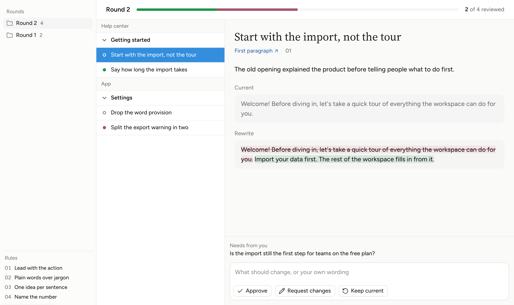

# Understudy

A theme for Claude artifacts that makes them look like part of the Claude desktop app. Same white ground as the chat beside them, the same neutral greys, quiet bordered controls and 16px text, and dark mode tuned for how the artifact pane draws color. Nothing on the page announces itself as a separate website.

<picture>
  <source media="(prefers-color-scheme: dark)" srcset="docs/preview-dark.png">
  
</picture>

It is plain CSS: a set of design tokens, one stylesheet of components, and five example pages, one per layout. The picture above is [examples/workspace-full-width.html](examples/workspace-full-width.html); it switches to dark with your GitHub theme.

This is an independent project. It is not made by, affiliated with or endorsed by Anthropic.

## What is in here

| File | What it is |
|---|---|
| `tokens.json` | Every color, type style, space, radius and size, with a note on where each one is used and where its value came from. The source of truth. |
| `tokens.css` | CSS custom properties built from `tokens.json`: light on `:root`, dark under `prefers-color-scheme` and under `data-theme="dark"`. |
| `components.css` | A base section every page needs, then one section per component, as `us-` classes. The components are listed below. |
| `examples/` | One page per layout preset, below. Open any of them in a browser. |
| `scripts/build-tokens.mjs` | Rebuilds `tokens.css` after you change `tokens.json`: `node scripts/build-tokens.mjs`. |
| `site/`, `scripts/build-site.mjs` | The website, [understudyui.com](https://understudyui.com). The build copies in the tokens, components and examples above, so the site always shows them as they are here. |

## How to use it

Artifacts can't load files from somewhere else, so everything goes inline.

**By hand.** Paste `tokens.css` at the top of the page's `<style>`. Then paste the **Base** section of `components.css` (the page background, links, the focus ring, text field focus and icon size), which every page needs, then the sections for the components the page uses. Each component's rules sit under one comment naming it, so a section can be copied on its own; where one builds on another, its comment says what it needs. Add the fonts:

```html
<link rel="stylesheet" href="https://fonts.googleapis.com/css2?family=Figtree:wght@400..600&display=swap">
<!-- Workspace pages only -->
<link rel="stylesheet" href="https://fonts.googleapis.com/css2?family=Source+Serif+4:opsz,wght@8..60,400&display=swap">
```

and, if the page uses icons, Lucide:

```html
<script src="https://cdn.jsdelivr.net/npm/lucide@0.460.0/dist/umd/lucide.min.js"></script>
<script>window.lucide?.createIcons({ attrs: { "stroke-width": 1.75 } });</script>
```

**With an agent.** Point it at this README and the example closest to what you want, and ask it to inline the tokens, the Base section and the component sections it uses. The rules below are written so an agent can follow them.

## Components

Each is one section of `components.css`.

| Component | Classes |
|---|---|
| Button | `us-btn`, with `us-btn-filled`, `us-btn-ghost`, `us-btn-primary`, `us-btn-success`, `us-btn-danger`, and `us-btn-sm` for a 28px button in table rows and filter bars. Toggles use `aria-pressed`. |
| Text input, textarea | `us-input`, `us-textarea` |
| Search field | `us-search`: a label around an icon and an `input type="search"`. |
| Select | `us-select`: a span around a native `select`; add `is-set` while it filters something. |
| Checkbox | `us-check`: a label around a native checkbox and its text. |
| Filter bar | `us-filters`: one wrapping row of search, selects, toggles and checkboxes, with `us-filters-end` and `us-filters-count` for the count on the right. |
| Tag | `us-tag`, with `us-tag-outline`, `us-tag-success`, `us-tag-danger` |
| Tabs | `us-tabs`, `us-tab` |
| List | `us-list`, `us-list-label`, `us-row`, `us-row-meta`, `us-row-action` |
| Card, quote, divider, rule | `us-card`, `us-quote`, `us-divider`, `us-rule` |
| Progress | `us-progress`, its parts `is-success`, `is-danger`, `is-muted` |
| Meta line | `us-meta`, `us-iconed` |
| Diff | `ins.us-ins`, `del.us-del` |
| Steps | `us-steps`, `us-step-num` |
| Status dot | `us-dot`: hollow when open, or `is-success`, `is-danger`, `is-muted` |
| Workspace | `us-workspace` (add `is-flat` for full width), `us-workspace-nav`, `us-workspace-main`, `us-canvas` |
| Nav top band | `us-nav-top`, `us-nav-title`: the nav's first band, the same height as the tracker beside it. |
| Nav hide and resize | `us-nav-toggle` (hide), `us-nav-toggle us-nav-expand` (show), `is-nav-hidden` on the workspace, `us-drag is-nav` (sets `--us-nav-w`). |
| Nav footer, icon button | `us-nav-foot`, `us-icon-btn` |
| Panel | `us-panel`, `us-panel-head`, `us-display`, `us-section-head` |
| Table | `us-table`, `us-table-wrap`, `us-num`, `us-name` |
| Table groups | `us-table-group` (the heading row), `us-table-toggle` (its button, with a chevron), `us-table-count`. One `tbody` per group; the button's `aria-expanded` folds it. |
| Fixed columns | `is-fixed` on the table, a `colgroup` of widths, `is-wrap` on a cell that wraps. |
| Sortable headers | `us-th-sort` (a button in each `th`), `aria-sort` on the sorted `th`. |
| Resizable columns | a `us-drag` in each `th` but the last, `--us-table-h` on the table, `is-resizable` on the wrap. |
| Rows that open | `us-row-toggle` (the first cell's button), `us-table-child` (the rows it shows). |
| Person, status, progress cell | `us-person`, `us-avatar` (`is-none` for nobody), `us-status`, `us-progress-cell` |
| Token value, file list, detail | `us-value`, `us-swatch`, `us-files`, `us-file`, `us-detail` |
| Tracker | `us-tracker`, `us-tracker-name`, `us-tracker-count` |
| Split | `us-split`, `us-split-col`, `us-split-list`, `us-split-group`, `us-split-heading`, `us-split-row`, `us-split-detail` |
| Split groups that fold | `us-split-group is-toggle` (a button with `aria-expanded`), `us-split-count` |
| Split row name and date | `us-split-name`, `us-split-sub`, `us-split-when` |
| Split page | `us-split-page`: the detail's content, at most `content-width` and centred. |
| Record | `us-record-title`, `us-record-where`, `us-record-text` |
| Dock and composer | `us-dock`, `us-composer`, `us-composer-actions` |
| Quote button, drag strip | `us-quote-btn`, `us-drag` |

## Layout presets

Every page: `body` on `bg`, a side gutter of `max(16px, env(safe-area-inset-left))` and the same on the right, `<meta name="claude:viewport-fit-sides" content="cover">`, and both themes from `tokens.css`.

- **Tool or tracker** ([examples/tool.html](examples/tool.html)). A review page, a checklist, a log. Up to 1080px wide. A short header, then a sticky bar with progress, counts and filter tabs. Items are open rows split by full-width hairlines, text on the left and controls on the right; the two columns stack under 860px. No cards around items.
- **Report** ([examples/report.html](examples/report.html)). Findings, a comparison, a write-up. One 760px column, a title and a date line, sections 32px apart. A key number goes in one card at the top, never a row of tiles.
- **Short page** ([examples/short-page.html](examples/short-page.html)). A note, a link list, a one-screen answer. Same column as the report, nothing sticky.
- **Workspace, cards** ([examples/workspace-cards.html](examples/workspace-cards.html)). A home page across many records: a project desk, settings, a file browser. A 240px nav on the left, a filter bar across the top, then panels on a grey canvas, each opening with a serif title. The example is a desk of projects: each panel holds a table grouped by area under folding headings, each row the project with a one-line status, its stage as a tag, when it was last touched and a small Copy prompt button that copies a prompt for starting a new Claude session on it. On a phone the table rows stack.
- **Workspace, full width** ([examples/workspace-full-width.html](examples/workspace-full-width.html)). One working surface you move through, such as a request tracker or a review queue. The same nav, then no canvas and no cards: a tracker across the top and a split list and detail below it, with resizable columns, folding groups and a status dot per record. The example tracks customer requests: the nav groups them by the shared ask or by customer and filters them by status, and the detail shows why they asked, what was committed, the other customers with the same ask and the issue. When each record needs a decision, dock it at the bottom of the detail like a message composer (`us-dock`, `us-composer`).

When unsure between the two Workspace layouts, pick full width for tools you work in and cards for pages you read or scan.

The project desk also ends with a Tasks panel: a table you sort from its headers, resize by dragging any column's edge, and open row by row to see each project's tasks. The full-width example shows the nav's top band, hiding the nav, the nav footer and folding Split groups.

### Workspace nav

- **Top band.** Open the nav with `us-nav-top`: the page's name in `us-nav-title` and, on the right, the button that hides the nav. It is exactly `top-bar-height` tall and the tracker beside it is at least that tall, so their hairlines meet in one line across the page.
- **Hiding.** The nav hides from that button (`us-nav-toggle`, with a `panel-left-close` icon and an `aria-label`) or Cmd or Ctrl and backslash. Add `is-nav-hidden` to the workspace. A second `us-nav-toggle us-nav-expand`, inside the workspace, appears at the top left to bring it back, and the tracker moves over to clear it. Move focus to whichever button is now showing.
- **Resizing.** Put a `us-drag is-nav` strip inside the workspace, after the nav. Dragging it sets `--us-nav-w` on the workspace; arrow keys move it 16px; double-click resets. Keep it between about 180 and 420px.
- **Remember** whether the nav is hidden and how wide it is in `localStorage`, wrapped in try/catch, since storage can be blocked. On a phone the nav stacks above the page, so the strip and the expand button do not show.
- **Footer.** `us-nav-foot` sits at the bottom of the nav: one short grey line, such as when the page was last read, with at most one `us-icon-btn` beside it. An icon button always has an `aria-label`.

### Split list

- **Folding groups.** Make the group band a button: `us-split-group is-toggle` with `aria-expanded`, a `chevron-down` icon (it turns to point right when folded), the group's name, and its count in `us-split-count` on the right. Leave a folded group's rows out of the list, and keep focus on the band after it folds.
- **Rows.** The record's name goes in `us-split-name`, which fills the row and ends in an ellipsis. A short relative date in `us-split-when` sits on the right: "3d", "2w", "4mo", with the full date or age in its `title`. Add a second grey line (`us-split-sub`, inside the name) only when the grouping hides where the record came from, such as the customer when rows are grouped by request.
- **Detail.** Wrap the record in `us-split-page`, so its lines stop at `content-width` and the page centres in a wide column.

### A table people work in

For a table someone sorts, resizes and opens, such as projects with their tasks.

- **One fact per column.** Put the lead, status, progress and date in their own columns rather than stacked under the name.
- **Fixed columns.** Add `is-fixed` and a `colgroup` of widths, so opening rows or sorting never shifts the columns. Cells end in an ellipsis; a cell that must wrap, such as a task title, takes `is-wrap`.
- **Sort from the headers.** Every header's text is a `us-th-sort` button. The sorted one shows a small `arrow-up` or `arrow-down` icon and its `th` carries `aria-sort`. Clicking it again flips the direction. No separate sort control elsewhere on the page.
- **Resize from any row.** Each header but the last holds a `us-drag` strip. Set `--us-table-h` on the table to its height with a ResizeObserver, so the strip runs the full height and follows rows as they open, and add `is-resizable` to the wrap so it never scrolls vertically and catches the wheel. Double-click resets. Remember the widths per browser.
- **Rows that open.** The first cell's `us-row-toggle` (a chevron, then the name) shows `us-table-child` rows underneath in the same columns: a task's title under the name, its owner under the person column, its status under the status column. Offer an Expand all or Collapse all button in the panel's head, and remember which rows are open.
- **People.** `us-person` with a `us-avatar` of initials. With nobody, `us-avatar is-none` (an outlined circle with a `user` icon) and a grey "Unassigned" or "No lead", so rows line up.
- **Status.** `us-status`: a status dot, then the word. The dots keep their meanings: hollow for open or not started, `is-success` for done, `is-danger` for something that needs someone, `is-muted` for in progress or parked. Use it instead of tags in a table, and never show a dot without its word.
- **Progress.** `us-progress-cell`: a short `us-progress` bar, then a count such as "3 of 8 done".

## Rules

**Copy.** Short, plain, sentence case: "Request changes", not "Request Changes". Labels are nouns, buttons are verbs. No emoji, no exclamation marks.

**Color.** Neutral greys with no hue. Text is `text`; anything secondary is `text-secondary`, never lighter. Links are `link`, the one cool blue. `success` and `danger` mean approved and removed, nothing else, and always come with a word. There is no brand accent; the strongest thing on a page is `strong`.

**Type.** One sans family at weight 450. Body 16/24, controls 15/20, meta 14/20, tags 12/16. Headings are body size at weight 600, not bigger; only the page title is 22/30. Nothing a person reads goes below 14px, except labels in the Workspace nav. The serif is for Workspace titles only.

**Spacing and shape.** A 4px base. Controls are 32px tall. Hairlines are 1px and run edge to edge of the pane (`us-rule`). Corners: 6px on tags and tabs, 8px on buttons and rows, 12px on inputs and cards, 20px on Workspace panels. No shadows on content.

**States.** Hover darkens the border or adds `bg-muted`. Focus is a 2px `focus` ring with a 2px offset on buttons, tabs, rows and links. Text fields take no ring, like the app's composer: the border steps up instead.

**Motion.** Almost none: 150 to 300ms ease-out on widths and colors, off under reduced motion.

**Icons.** Lucide outlines at 16px with a 1.75 stroke in `currentColor`, beside a label, never alone where a word would be clearer. Before the verb on action buttons, after the text on links that leave the page, before the thing a meta line names.

## What was measured and what was assumed

Measured from screenshots of the Claude desktop app in October 2026: the light theme colors, the 16px body text (checked against the chat and file viewer beside an open artifact), the 32px rows and the 8px and 12px corners. Dark values were measured from the app in dark mode.

The artifact pane draws dark colors about a third lighter than the code sets them (`#1c1c1c` shows as `#252525`). So dark surfaces, lines and the link color are set a step lower than they appear, to land on the app's colors inside the pane. In an ordinary browser, dark mode looks a touch darker than the app.

Assumed, not measured: the typefaces (the app's own are not available, so Figtree and Source Serif 4 stand in as the closest open matches), the 6px tag radius, the motion timings, and a few dark values marked in `tokens.json`.

The app will change. When it does, these values will drift until someone measures again. Pull requests with fresh measurements are welcome; say what you measured and how.

## Credits and licenses

Made by [Kelvin Man](https://kelvinman.com). Released under the [MIT license](LICENSE). The license covers the code and tokens; the Understudy name and mark are not included.

Understudy loads these from public CDNs and does not bundle them:

- [Figtree](https://fonts.google.com/specimen/Figtree) by Erik Kennedy, SIL Open Font License 1.1.
- [Source Serif 4](https://fonts.google.com/specimen/Source+Serif+4) by Adobe, SIL Open Font License 1.1.
- [Lucide](https://lucide.dev) icons, ISC license.

Claude is a trademark of Anthropic. It is named here only to say what the theme is for.
